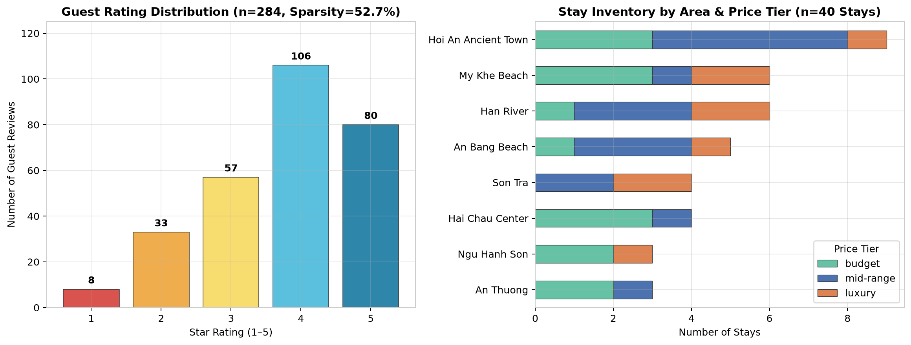
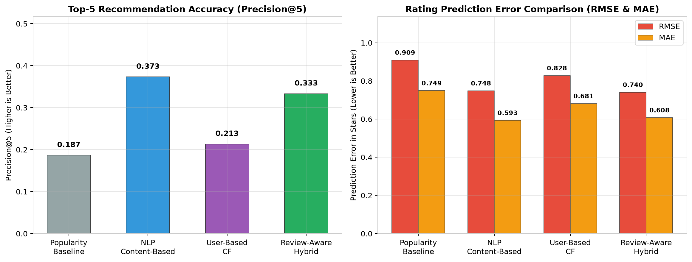
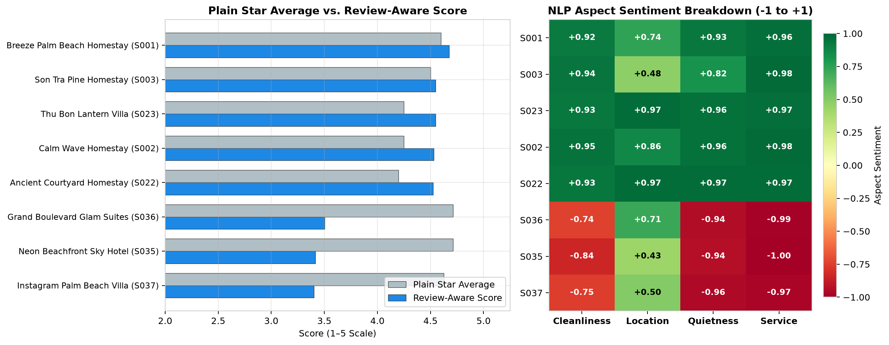

# Hotel and Homestay Review-Aware Recommender (MP-A13)

| Field | Details |
| :--- | :--- |
| **Course** | CS467 – Advanced Artificial Intelligence (2026–2027) — Assignment 15 |
| **Student Name** | Nguyễn Ngọc Hoàng Thái |
| **Student ID / Section** | `29211151440` \| `CS467A (No. 13)` |
| **Instructor** | Puri Vikram |
| **Project Code** | `MP-A13` |
| **Project Title** | Hotel and Homestay Review-Aware Recommender |
| **Application Domain** | Hospitality and Accommodation Booking (Da Nang & Hoi An) |
| **GitHub Repository** | `cs467-miniproject-29211151440` |

---

## 1. Problem Statement

Travelers searching for a hotel or homestay rarely make decisions based on a single overall star rating alone. A flashy beachfront property may achieve a **4.6–4.7★ average** because visitors admire its rooftop infinity pool or sunset views, while candid guest reviews repeatedly complain about **noisy streets at night**, **unclean bathrooms**, **slow Wi-Fi**, or **unhelpful staff**. Conversely, a quiet family-run homestay with spotless rooms and reliable fiber Wi-Fi may sit lower in plain star-average rankings.

This mini-project builds an end-to-end Python **Review-Aware Hospitality Recommender** that combines:
1. **Natural Language Processing (NLP):** text cleaning, TF-IDF vectorization with shared query projection, and clause-level negation-aware aspect-sentiment scoring across four key stay qualities (**cleanliness**, **location**, **quietness**, **service**).
2. **Recommendation Systems:** a comparative pipeline spanning a **Popularity Baseline**, an **NLP Content-Based Recommender**, **User-Based Collaborative Filtering (UBCF)**, and a **Review-Aware Hybrid Recommender** that handles both returning guests and cold-start natural-language stay queries.

---

## 2. Dataset Description

A clean, realistic custom hospitality dataset modeled around **Da Nang and Hoi An, Vietnam** was constructed specifically for this assignment and stored in `data/`:

* **`data/items.csv` (40 stays)**
  * **Columns:** `item_id`, `stay_name`, `area`, `price_tier`, `amenities_text`, `description`
  * **Coverage:** 8 realistic areas (`Hoi An Ancient Town`, `My Khe Beach`, `Han River`, `An Bang Beach`, `Son Tra`, `Hai Chau Center`, `Ngu Hanh Son`, `An Thuong`) across 3 price tiers (`budget`, `mid-range`, `luxury`), spanning quiet coastal homestays, luxury resorts, central business hotels, heritage villas, lively backpacker hostels, and flashy "star-inflated" properties whose reviews expose aspect flaws.
* **`data/ratings.csv` (284 guest reviews across 15 guests)**
  * **Columns:** `user_id`, `item_id`, `rating` (1–5 integer stars), `guest_review`
  * **Sparsity & Quality:**
    * **Users:** 15 guests (`U001`–`U015`) representing 5 distinct traveler profiles (remote-work quiet beach seekers, luxury wellness guests, central business travelers, heritage culture travelers, and social budget backpackers).
    * **Matrix Sparsity:** $1 - \frac{284}{15 \times 40} = \mathbf{52.67\%}$ missing entries (within the 40%–65% realistic sparsity target).
    * **Ratings per User:** min = `14`, max = `23`, mean = `18.93` (exceeding the minimum 4–6 ratings/user check).
    * **Ratings per Stay:** min = `5`, max = `10`, mean = `7.10`.
    * **Text Diversity:** All **284 guest reviews are 100% unique**, referencing real areas and expressing fine-grained praise or complaints across cleanliness, location, quietness, service, and Wi-Fi.

*(Dataset note: All stay names, descriptions, and guest reviews are original synthetic data authored for educational NLP and recommender evaluation in CS467.)*

---

## 3. NLP and Recommendation Methods

### 3.1. NLP Pipeline (`src/nlp_pipeline.py`)
1. **Text Preprocessing:** Lowercasing, Wi-Fi normalization (`wi-fi` / `wi fi` → `wifi`), punctuation/extra-space removal, tokenization, and curated English stop-word removal.
2. **TF-IDF Representation & Shared Query Vectorization (`StayNLPPipeline`):**
   * Combines preprocessed stay metadata (`stay_name`, `area`, `price_tier`, `amenities_text`, `description`) with aggregated training `guest_review` text.
   * Fits a single `TfidfVectorizer(ngram_range=(1, 2), sublinear_tf=True)`.
   * Provides `vectorize_query(query_text)` to project any new natural-language stay request onto the **exact same fitted vocabulary**, and `get_matching_keywords()` to extract top TF-IDF overlapping keywords for transparent explanations.
3. **Clause-Level Negation-Aware Aspect Sentiment:**
   * Splits each review on punctuation and contrast conjunctions (`but`, `however`, `yet`, `though`, `although`) so positive praise (e.g., *"Stunning views"*) does not contaminate negative aspect clauses (e.g., *"but the bathroom was not clean and staff were unhelpful"*).
   * Detects 4 hospitality aspects (`cleanliness`, `location`, `quietness`, `service`) via domain keyword lexicons, applies a 3-token negation window (`not`, `no`, `never`, `barely`, etc.), and aggregates mean aspect sentiment scores in $[-1.0, +1.0]$ per stay.
   * Also implements `detect_query_aspects(query_text)` to infer aspect priority weights from natural-language user queries.

### 3.2. Recommendation Models (`src/recommender.py`)
1. **Popularity Baseline (`PopularityRecommender`):**
   * Filters stays with `< 3` ratings and excludes stays already rated by the target user.
   * Ranks candidates by Bayesian weighted rating:
     $$W_i = \frac{v_i}{v_i + m} R_i + \frac{m}{v_i + m} C$$
     where $R_i$ is the stay's average star rating, $v_i$ is its rating count, $m = 3$, and $C$ is the global mean rating.
2. **NLP Content-Based Recommender (`ContentBasedRecommender`):**
   * Uses **cosine similarity** on TF-IDF vectors to support:
     * **Free-text query recommendations** (`recommend_by_query`)
     * **User-profile recommendations** (`recommend_for_user`, weighted average TF-IDF vector of stays rated $\ge 4$)
     * **Item-to-item similar stays** (`recommend_similar_items`)
   * Returns Top-5 stays with cosine similarity scores and top matching keywords.
3. **User-Based Collaborative Filtering (`UserBasedCFRecommender`):**
   * Computes **co-rated Pearson correlation with significance weighting (shrinkage)** ($\lambda = 3.0$) across overlapping stays:
     $$\text{sim}(u, v) = \frac{n_{uv}}{n_{uv} + \lambda} \cdot \frac{\sum_{i \in I_{uv}} (r_{ui} - \bar{r}_u)(r_{vi} - \bar{r}_v)}{\sqrt{\sum_{i \in I_{uv}} (r_{ui} - \bar{r}_u)^2}\sqrt{\sum_{i \in I_{uv}} (r_{vi} - \bar{r}_v)^2}}$$
   * Predicts ratings for unrated stays from top-$k$ ($k = 4$) positively correlated neighbors via mean-centered deviation averaging.
4. **Review-Aware Hybrid Recommender (`HybridReviewAwareRecommender`):**
   * **Returning Guests:** Blends normalized UBCF score ($0.40$), NLP Content-Based profile similarity ($0.45$), and normalized NLP Aspect Sentiment ($0.15$).
   * **Cold-Start / Natural-Language Query Guests:** Combines query TF-IDF cosine similarity ($0.55$), query-weighted aspect sentiment ($0.30$), and Bayesian popularity prior ($0.15$).
   * **Review-Aware Ranking Comparison:** Converts overall aspect sentiment $a_i \in [-1, +1]$ to a 1–5 star equivalent ($3.0 + 2.0 \cdot a_i$) and computes:
     $$R_{\text{review-aware}}(i) = 0.55 \cdot R_i + 0.45 \cdot (3.0 + 2.0 \cdot a_i)$$

---

## 4. Project Structure

```text
cs467-miniproject-29211151440/
├── README.md
├── requirements.txt
├── .gitignore
├── data/
│   ├── items.csv
│   └── ratings.csv
├── src/
│   ├── nlp_pipeline.py
│   ├── recommender.py
│   ├── evaluate.py
│   └── main.py
├── notebooks/
│   └── demo.ipynb
└── results/
    ├── sample_outputs.txt
    ├── data_distribution.png
    ├── model_comparison.png
    └── aspect_sentiment_comparison.png
```

---

## 5. Installation and Run Commands

### Setup
```bash
git clone https://github.com/AlexTh4i/cs467-miniproject-29211151440.git
cd cs467-miniproject-29211151440

python3 -m venv venv
source venv/bin/activate        # On Windows: venv\Scripts\activate
pip install -r requirements.txt
```

### Run Offline Evaluation & Generate Charts
```bash
python src/evaluate.py
```
This runs the leak-free per-user train/test split, evaluates all 4 models, saves the 3 test case outputs to `results/sample_outputs.txt`, and generates the 3 plots inside `results/`.

### Run the CLI Demo
```bash
# Run all 3 required test cases + sample user (U001) comparison
python src/main.py

# Recommend for a specific existing guest (U001..U015)
python src/main.py --user U001

# Recommend for any custom natural-language stay query (Cold-Start supported)
python src/main.py --query "quiet homestay near beach with strong wifi and friendly host"

# Launch interactive terminal menu (great for live Q&A demo)
python src/main.py --interactive
```

You can also explore the step-by-step interactive walkthrough in `notebooks/demo.ipynb`.

---

## 6. Sample Outputs for All 3 Required Test Cases

*(Full saved log available in `results/sample_outputs.txt`.)*

### Test Case 1: Stay Query
**Query:** `'quiet homestay near beach with strong wifi and friendly host'`  
**Detected Query Aspect Weights:** `cleanliness=0.10, location=0.34, quietness=0.22, service=0.34`

```text
[1A] NLP Content-Based (TF-IDF Cosine Similarity) - Top 5:
  #1 [S005] Coral Cove Quiet Homestay (My Khe Beach, mid-range) | TF-IDF Score: 0.2121
      Keywords: near beach, friendly host, quiet homestay, host, beach
  #2 [S002] Calm Wave Homestay (My Khe Beach, budget) | TF-IDF Score: 0.2036
      Keywords: near beach, homestay, friendly host, beach, beach strong
  #3 [S004] Lantern Sand Beach Homestay (An Bang Beach, mid-range) | TF-IDF Score: 0.2030
      Keywords: quiet homestay, homestay, friendly host, beach, host
  #4 [S006] Driftwood Garden Homestay (An Bang Beach, budget) | TF-IDF Score: 0.1961
      Keywords: near beach, friendly host, quiet homestay, homestay, beach
  #5 [S007] Ocean Whisper Villa Homestay (Son Tra, mid-range) | TF-IDF Score: 0.1919
      Keywords: homestay, friendly host, beach strong, host, strong wifi

[1B] Review-Aware Hybrid (Query TF-IDF + Aspect Sentiment + Popularity) - Top 5:
  #1 [S005] Coral Cove Quiet Homestay (My Khe Beach, mid-range) | Hybrid Score: 0.9390 | TF-IDF: 0.2121 | Aspect Sent: +0.855
      Details: TF-IDF=0.212 | Aspects(clean=+0.92, loc=+0.66, quiet=+0.88, serv=+0.96) | Keywords: near beach, friendly host, quiet homestay, host, beach
  #2 [S002] Calm Wave Homestay (My Khe Beach, budget) | Hybrid Score: 0.9348 | TF-IDF: 0.2036 | Aspect Sent: +0.937
      Details: TF-IDF=0.204 | Aspects(clean=+0.95, loc=+0.86, quiet=+0.96, serv=+0.98) | Keywords: near beach, homestay, friendly host, beach, beach strong
  #3 [S006] Driftwood Garden Homestay (An Bang Beach, budget) | Hybrid Score: 0.9112 | TF-IDF: 0.1961 | Aspect Sent: +0.931
      Details: TF-IDF=0.196 | Aspects(clean=+0.94, loc=+0.87, quiet=+0.95, serv=+0.96) | Keywords: near beach, friendly host, quiet homestay, homestay, beach
  #4 [S004] Lantern Sand Beach Homestay (An Bang Beach, mid-range) | Hybrid Score: 0.9003 | TF-IDF: 0.2030 | Aspect Sent: +0.842
      Details: TF-IDF=0.203 | Aspects(clean=+0.92, loc=+0.59, quiet=+0.91, serv=+0.95) | Keywords: quiet homestay, homestay, friendly host, beach, host
  #5 [S007] Ocean Whisper Villa Homestay (Son Tra, mid-range) | Hybrid Score: 0.8958 | TF-IDF: 0.1919 | Aspect Sent: +0.907
      Details: TF-IDF=0.192 | Aspects(clean=+0.92, loc=+0.78, quiet=+0.97, serv=+0.96) | Keywords: homestay, friendly host, beach strong, host, strong wifi
```

### Test Case 2: Review-Aware Comparison vs. Plain Star Average

Plain star average places flashy, photogenic properties at Ranks #1–#3 even though guest reviews consistently report dirty bathrooms, loud night noise, and rude/unhelpful staff. Incorporating NLP aspect sentiment demotes all four star-inflated stays by **26 to 29 ranks** and elevates genuinely clean, quiet, well-hosted stays to the Top 5:

| Plain Rank | Review-Aware Rank | Rank Change | Stay | Plain Star Avg | Aspect Sentiment | Review-Aware Score |
| :---: | :---: | :---: | :--- | :---: | :---: | :---: |
| 1 | **30** | **-29** | `S035` Neon Beachfront Sky Hotel | 4.714 | **-0.587** | 3.414 |
| 1 | **29** | **-28** | `S036` Grand Boulevard Glam Suites | 4.714 | **-0.488** | 3.504 |
| 3 | **31** | **-28** | `S037` Instagram Palm Beach Villa | 4.625 | **-0.545** | 3.403 |
| 6 | **32** | **-26** | `S038` Old Town Flash Boutique | 4.333 | **-0.557** | 3.232 |
| 4 | **1** | **+3** | `S001` Breeze Palm Beach Homestay | 4.600 | **+0.885** | **4.677** |
| 5 | **2** | **+3** | `S003` Son Tra Pine Homestay | 4.500 | **+0.804** | **4.548** |
| 7 | **3** | **+4** | `S023` Thu Bon Lantern Villa | 4.250 | **+0.956** | **4.548** |
| 7 | **4** | **+3** | `S002` Calm Wave Homestay | 4.250 | **+0.937** | **4.531** |
| 9 | **5** | **+4** | `S022` Ancient Courtyard Homestay | 4.200 | **+0.961** | **4.525** |

### Test Case 3: Cold-Start Test (Brand-New Guest with Natural-Language Request)
**Guest ID:** `NEW_GUEST_01` (0 prior ratings)  
**Request:** `'peaceful heritage homestay near ancient town with spotless room, kind local host, and reliable wifi'`  
**Detected Query Aspect Weights:** `cleanliness=0.20, location=0.30, quietness=0.20, service=0.30`

```text
[3A] Review-Aware Cold-Start Hybrid - Top 5:
  #1 [S022] Ancient Courtyard Homestay (Hoi An Ancient Town, mid-range) | Hybrid Score: 0.9583 | TF-IDF: 0.3666 | Aspect Sent: +0.961
      Details: TF-IDF=0.367 | Aspects(clean=+0.93, loc=+0.97, quiet=+0.97, serv=+0.97) | Keywords: town, ancient, ancient town, local host, host reliable
  #2 [S023] Thu Bon Lantern Villa (Hoi An Ancient Town, mid-range) | Hybrid Score: 0.8530 | TF-IDF: 0.2948 | Aspect Sent: +0.956
      Details: TF-IDF=0.295 | Aspects(clean=+0.93, loc=+0.97, quiet=+0.96, serv=+0.97) | Keywords: town, heritage, ancient town, ancient, town spotless
  #3 [S027] Old Quarter Tailor Inn (Hoi An Ancient Town, mid-range) | Hybrid Score: 0.8449 | TF-IDF: 0.2974 | Aspect Sent: +0.906
      Details: TF-IDF=0.297 | Aspects(clean=+0.91, loc=+0.79, quiet=+0.95, serv=+0.97) | Keywords: town spotless, ancient, town, ancient town, heritage
  #4 [S025] Cam Nam Heritage House (Hoi An Ancient Town, mid-range) | Hybrid Score: 0.8441 | TF-IDF: 0.3039 | Aspect Sent: +0.900
      Details: TF-IDF=0.304 | Aspects(clean=+0.92, loc=+0.78, quiet=+0.94, serv=+0.96) | Keywords: ancient, town, ancient town, heritage, town spotless
  #5 [S024] Rice Field Breeze Homestay (Hoi An Ancient Town, budget) | Hybrid Score: 0.7963 | TF-IDF: 0.2706 | Aspect Sent: +0.909
      Details: TF-IDF=0.271 | Aspects(clean=+0.95, loc=+0.81, quiet=+0.92, serv=+0.96) | Keywords: town, ancient, ancient town, heritage, town spotless
```
Pure User-Based CF cannot personalize for `NEW_GUEST_01` because no interaction row exists; the Review-Aware Cold-Start Hybrid immediately returns 5/5 peaceful, spotless Hoi An Ancient Town heritage stays verified by positive aspect sentiment.

---

## 7. Evaluation Results and Visualizations

### Offline Evaluation Table
Using a **per-user holdout split** (25% / $\ge 3$ hidden ratings per guest: **213 train / 71 test ratings**, `random_state=42`, relevance threshold $\ge 4\star$), all NLP vectorizers, aspect sentiment profiles, and recommender matrices were fitted **strictly on the training split** to prevent data leakage:

| Method | Precision@5 (↑) | Recall@5 (↑) | RMSE (↓) | MAE (↓) |
| :--- | :---: | :---: | :---: | :---: |
| **Popularity Baseline** | 0.1867 | 0.2333 | 0.9094 | 0.7493 |
| **User-Based CF (UBCF)** | 0.2133 | 0.2900 | 0.8278 | 0.6814 |
| **NLP Content-Based** | **0.3733** | **0.5767** | 0.7483 | **0.5933** |
| **Review-Aware Hybrid** | 0.3333 | 0.4822 | **0.7403** | 0.6075 |

### Visual Analysis

#### 1. Dataset Rating Distribution & Stay Inventory


#### 2. Offline Model Comparison (Precision@5, RMSE, MAE)


#### 3. Plain Star Average vs. Review-Aware Score & NLP Aspect Sentiment Breakdown


---

## 8. Reflection: What Worked Well & Limitations

### What Worked Well
* **Clause-level contrast splitting + negation handling** dramatically improved aspect sentiment accuracy: reviews like *"Stunning views in My Khe Beach, **but** the bathroom was not clean and loud street noise shook the windows"* properly scored **positive for location** while scoring **strongly negative for cleanliness and quietness**.
* **Review-Aware Hybrid** delivered the **lowest rating prediction RMSE (`0.7403`)** across all methods, outperformed the Popularity Baseline by **+78.5% in Precision@5**, outperformed standalone UBCF by **+56.3% in Precision@5**, and successfully protected users from noisy/unclean star-inflated stays (Test Case #2) while solving cold-start requests seamlessly (Test Case #3).
* **Transparent explainability:** Every recommendation surfaces its top matching TF-IDF keywords and per-aspect sentiment scores (`clean`, `loc`, `quiet`, `serv`), making rankings easy for travelers to trust.

### Limitations & Future Improvements
* **Raw star-matching trade-off vs. pure Content-Based:** On offline Precision@5 evaluated strictly against historical star counts, pure NLP Content-Based (`0.3733`) edged out Review-Aware Hybrid (`0.3333`) because our Hybrid deliberately penalizes star-inflated stays (`S035`–`S038`) that had 4–5 star labels in the test split despite negative review text. A user-preference model that learns *which* guests ignore noise vs. prioritize quietness would reconcile this trade-off.
* **Small user pool for CF:** With only 15 guests and 52.67% sparsity, User-Based CF has relatively few co-rated neighbors per user, limiting standalone CF precision compared to text-rich NLP matching.
* **Lexicon-based NLP constraints:** Keyword-based aspect detection cannot fully capture sarcasm, implicit complaints, or synonyms absent from the lexicon. Future versions could adopt lightweight pretrained sentence embeddings (for semantic query matching) and fine-tuned Aspect-Based Sentiment Analysis (ABSA) transformers.
